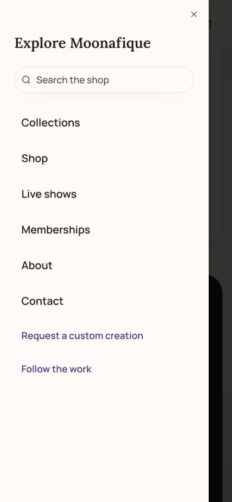

# Whatnot inventory and membership signup

Published November 7, 2026 to both `www.moonafique.com` and `moonafique.com`. Application source: `b97e4eea9f466c1d330c4ddbf167c5d6b35f6706`. Vercel deployment: `dpl_6KRXNaZv3tg55qBVuaunTmEAHNoE`. Previous production / rollback reference: `dpl_7Ut7uxyXttqzFD5RGZ94YEQFQXkc`.

The Grim of the Month showcase reads remaining stock from Whatnot. The October 2026 edition maps to the owner-confirmed product `661335701`, “October Grimm of the Month.” Whatnot initially returned no variants for this product. After the owner added a variant, the production credential returned one available item.

## Inventory behavior

- `WHATNOT_INVENTORY_API_TOKEN` stays in the Vercel Production environment and is used only on the server. It must read the seller identity, mapped products, and their variants. This feature does not call customer, order, financial report, or inventory-write endpoints.
- The adapter verifies the Moonafique account and exact product ID/title, follows bounded pagination, and totals the product’s variant quantities. It rejects malformed quantities, foreign product IDs, duplicate variants, and incomplete responses.
- The shared server cache refreshes on demand every two minutes. Open, visible pages check every minute and when the visitor returns. Updates normally appear within a few minutes; this is not a real-time inventory reservation.
- Only edition keys, quantities, and the synchronization time reach the public `/api/grim-showcase` endpoint. A verified zero means sold out. Missing variants or a failed/expired connection never become zero. Counts older than five minutes disappear in favor of a Whatnot availability link.
- August and September remain editorially vaulted. October becoming sold out does not permanently vault it. Add each new monthly product once in `lib/whatnot-inventory-api.ts`, together with the new showcase edition; remaining counts need no manual updates.
- The build readiness check reads inventory without changing listings. Whatnot confirms stock at purchase.

## Membership signup and navigation

Visitors can compare memberships before signing in. Sign-in now precedes the editable preferences and delivery form on both the Grimmunity and ACEO pages. The return URL brings the visitor back to the membership section.

If an authenticated session expires during a shipping quote or checkout attempt, the form saves only editable fields and membership choices in that browser tab’s session storage, for up to 30 minutes. The restored draft is consumed once and must match the program, club, edition, supported tier, and country. Quotes, consent, payment data, and request keys are never restored. Visitors calculate shipping and review the agreement again. If browser storage is blocked, the form stays open with a separate sign-in link.

Opening the mobile menu focuses its heading, leaving search available by tapping or tabbing. Escape closes the menu and returns focus to the menu button.

## Verification

- 73 storefront tests passed, including 17 inventory adapter and display checks.
- 211 membership tests passed against a new disposable local `grim_test` PostgreSQL database, including nine signup draft and return-URL checks. No production records were used.
- TypeScript and lint passed for changed files. Vercel built the production candidate successfully with the real inventory credential.
- A browser check with simulated sign-in and a simulated expired-session quote restored all six colors, avoided colors, delivery fields, and six-month billing. The quote and agreement remained unset. The harness lived only in a temporary source copy and is not shipped.
- At 390 × 844, the menu focused the heading, Tab reached search, Escape returned focus to Open menu, and the page had no horizontal overflow.
- Staged and public checks verified October stock of one from Whatnot, public plan comparisons and sign-in entry points, existing show sync, house attribution, active newsletter readiness, membership availability, route authorization, and 18 client bundles without secrets.

The public browser also verified the authenticated form, updated shipping instructions, October’s imported one-copy badge, and mobile menu focus on the heading. The anonymous HTTP checks verified sign-in before editing on both collection pages. No real purchase or label was created.

## Private records and shipping

No customer or financial records were imported and no real order or shipping label was created. A future private bookkeeping export can reconcile order IDs, SKUs, sales, discounts, refunds, commission, processing fees, shipping adjustments, and net earnings. Keep buyer contact details limited to fulfillment and support.

The current published REST API lists order retrieval and cancellation, not external order creation. Label generation applies to an existing Whatnot shipment. Whatnot commission and payment processing still apply to actual Whatnot sales; the commission rate depends on category and the seller’s current volume tier.

Sources: [Products](https://developers.whatnot.com/api-reference/tag/products), [Orders](https://developers.whatnot.com/api-reference/tag/orders), [Reports](https://developers.whatnot.com/reports), [Seller fees](https://help.whatnot.com/hc/en-us/articles/4847069165965-Whatnot-seller-fees).
